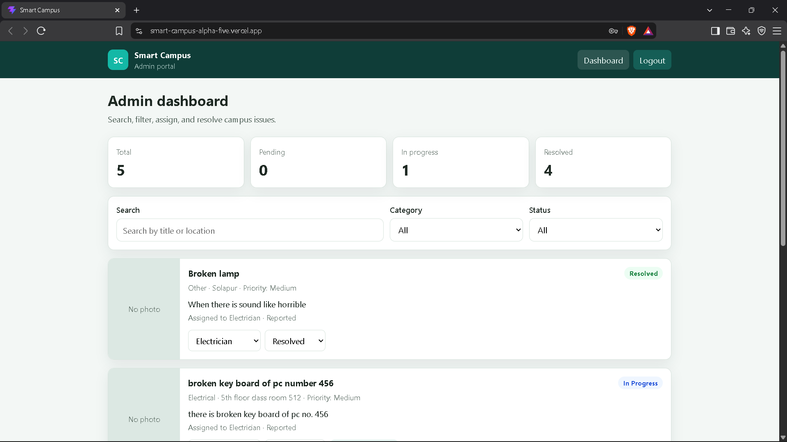

# Smart Campus

## What it is

A campus maintenance management system. Students can report issues and track their status. Administrators can search, assign, and manage reports.

## Features

- Students can report campus maintenance issues.
- Students can track report status.
- Administrators can search reports.
- Administrators can assign reports.
- Administrators can manage reports.

## Screenshots

## Stack

React, Vite, Supabase, PostgreSQL, and Vercel.

## Run locally

TODO(sanskar): Confirm the Smart Campus repository's local setup commands.

## Environment variables

TODO(sanskar): List the required environment variable names only. The portfolio repository does not document Smart Campus variables.

## Deployment

Live URL listed in the portfolio: https://smart-campus-alpha-five.vercel.app/

TODO(sanskar): Confirm the deployment steps.

## What to improve

TODO(sanskar): Add the next improvements you have chosen.
